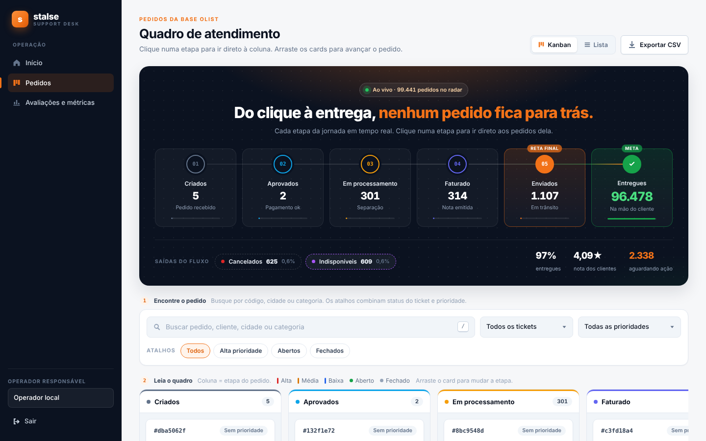
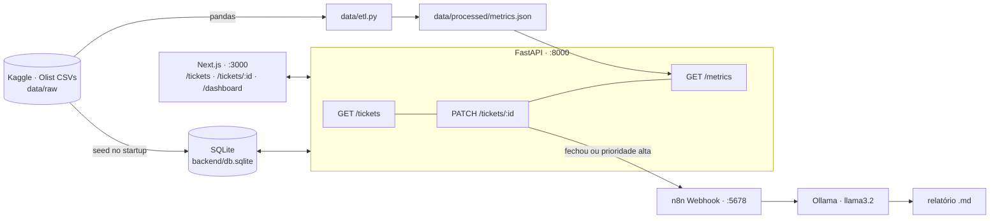
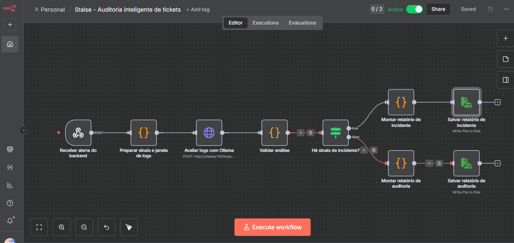
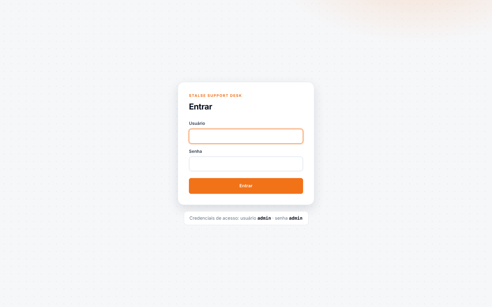
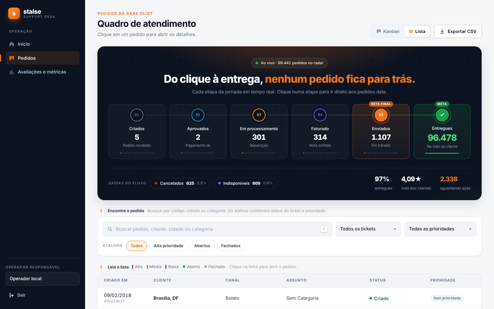
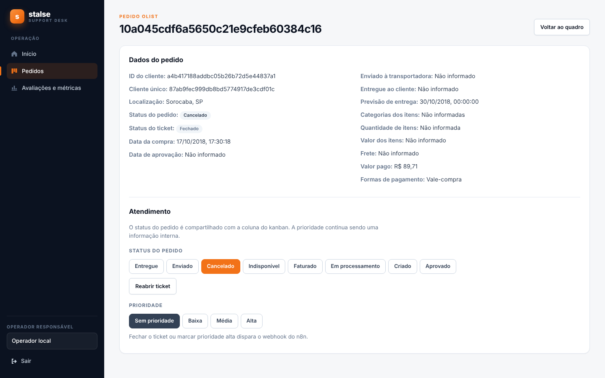
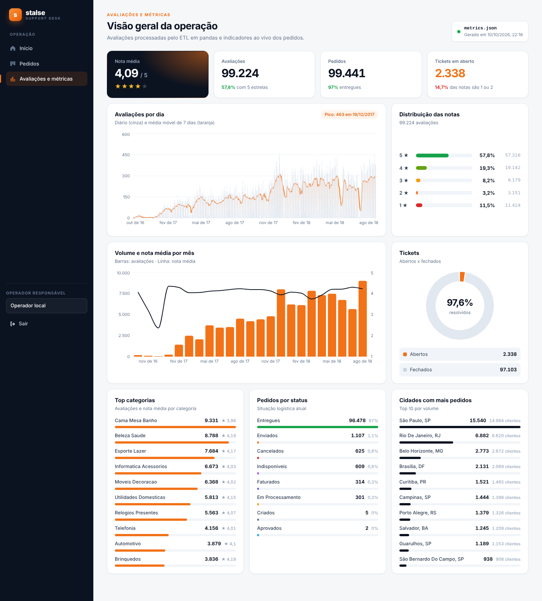

# Stalse · Mini Inbox Olist

Desafio técnico FullStack da Stalse: um **inbox de atendimento** sobre os **99.441 pedidos reais da Olist**.
Stack: **FastAPI + SQLite**, **Next.js (App Router)**, **pandas** (ETL) e **n8n** (webhook).



---

## ✅ Critérios do desafio

| Critério | Como foi atendido | Onde |
|---|---|---|
| `GET /tickets` | Lista paginada com busca (`q`), filtros (`status`, `ticket_status`, `priority`) e total | `backend/main.py` |
| `PATCH /tickets/{id}` | Altera `order_status` e/ou `priority`; o status do ticket (aberto/fechado) é derivado do status do pedido | `backend/main.py` |
| `GET /metrics` | Lê `data/processed/metrics.json` (gerado pelo pandas) e soma indicadores dos pedidos | `backend/main.py` |
| Seeds no start | No startup, o backend cria o SQLite e carrega os CSVs da Olist (**99.441 tickets**, além dos ~20 pedidos) | `ensure_db()` |
| Persistência SQLite | Arquivo `backend/db.sqlite`, criado automaticamente | `backend/` |
| `/tickets` | Tabela com **criado em, cliente, canal, assunto, status e prioridade**, busca por texto e visão Kanban | `frontend/app/tickets` |
| `/tickets/[id]` | Detalhe do pedido + **botões** para mudar status e prioridade | `frontend/app/tickets/[id]` |
| `/dashboard` | Cards e gráficos do `GET /metrics` | `frontend/app/dashboard` |
| ETL pandas + Kaggle | Lê o CSV, faz parse de data e gera **quantidade por dia**, por mês, por nota e **top categorias** | `data/etl.py` |
| Saída do ETL | `data/processed/metrics.json` | `data/processed/` |
| n8n: webhook | POST do backend quando o ticket **fecha** ou vira **prioridade alta** | `n8n/workflow.json` |
| n8n: ação | Analisa os logs com IA local (Ollama) e grava um relatório `.md` | `n8n/reports/` |
| Prints | Interface e n8n | `screenshots/`, `n8n/screenshot.png` |

---

## 🧭 Arquitetura



---

## 🚀 Como rodar

### Opção 1: Docker (tudo de uma vez)

```bash
docker compose up --build
```

| Serviço | URL |
|---|---|
| Frontend | http://localhost:3000 (login **admin / admin**) |
| API + Swagger | http://localhost:8000/docs |
| n8n | http://localhost:5678 |

> Na primeira execução o container roda o ETL, cria o SQLite, importa e ativa o workflow do n8n e baixa o modelo do Ollama.

### Opção 2: Local (sem Docker)

Requer **Python 3.10+** e **Node 20+**.

```bash
# 1. Backend + ETL
python3 -m venv .venv && source .venv/bin/activate      # Windows: .venv\Scripts\Activate.ps1
pip install -r backend/requirements.txt
python data/etl.py                                       # gera data/processed/metrics.json
python -m uvicorn main:app --app-dir backend --reload --port 8000

# 2. Frontend (outro terminal)
cd frontend && npm ci && npm run dev
```

Acesse http://localhost:3000 e entre com **admin / admin**. As credenciais aparecem na própria tela de login.

---

## 🔌 API

| Método | Rota | Descrição |
|---|---|---|
| `GET` | `/tickets?q=&status=&ticket_status=&priority=&limit=&offset=` | Lista paginada com busca e filtros |
| `GET` | `/tickets/board` | Pedidos agrupados por status (Kanban) |
| `GET` | `/tickets/{id}` | Detalhe |
| `PATCH` | `/tickets/{id}` | Body `{"order_status": "...", "priority": "low\|medium\|high\|null"}`, header `X-Operator-Name` |
| `GET` | `/metrics` | Métricas do ETL + indicadores dos pedidos |

```bash
curl -X PATCH http://localhost:8000/tickets/123 \
  -H "Content-Type: application/json" -H "X-Operator-Name: Maria" \
  -d '{"priority": "high"}'
```

### Ticket ↔ dataset Olist

O dataset não tem os campos de um ticket de suporte, então cada pedido vira um ticket com este mapeamento:

| Campo pedido no desafio | Campo usado |
|---|---|
| `created_at` | `order_purchase_timestamp` |
| `customer_name` | cidade/UF do cliente (o dataset é anonimizado) |
| `channel` | forma de pagamento (cartão, boleto…) |
| `subject` | categoria do produto |
| `status` | `open` / `closed` (fechado = entregue ou cancelado) |
| `priority` | `low` / `medium` / `high` (definida pelo operador) |

---

## 📊 Dados (pandas + Kaggle)

- **Dataset:** [Brazilian E-Commerce Public Dataset by Olist](https://www.kaggle.com/datasets/olistbr/brazilian-ecommerce), licença CC BY-NC-SA 4.0. Os CSVs já estão em `data/raw/`, então não precisa de token do Kaggle.
- **`data/etl.py`:** lê `olist_order_reviews_dataset.csv`, faz `pd.to_datetime` na data e cruza com itens e produtos para obter a categoria. Gera:

```jsonc
// data/processed/metrics.json (resumo)
{
  "summary":     { "total_records": 99224, "average_rating": 4.09 },
  "by_day":      [{ "date": "2017-11-24", "count": 270 }, ...],
  "by_month":    [{ "month": "2018-08", "count": 8987, "average_rating": 4.21 }, ...],
  "by_rating":   [{ "rating": "5", "count": 57328 }, ...],
  "by_category": [{ "category": "cama_mesa_banho", "count": 9331, "average_rating": 3.98 }, ...]
}
```

O backend só **lê** esse arquivo no `GET /metrics`.

---

## 🤖 n8n

**Gatilho:** o `PATCH /tickets/{id}` envia um POST para `http://localhost:5678/webhook/stalse-ticket` quando o ticket passa a **`closed`** ou a prioridade passa a **`high`**.

```json
{
  "event": "ticket_review_requested",
  "triggers": ["priority_high"],
  "actor": "Maria",
  "ticket_id": 123,
  "order_id": "10a045cdf6a5650c21e9cfeb60384c16",
  "ticket_status": "open",
  "order_status": "processing",
  "priority": "high",
  "updated_at": "2026-10-10T13:00:00",
  "logs_window_minutes": 15,
  "logs": [{ "event": "ticket_updated", "...": "..." }]
}
```

**Fluxo:** Webhook → prepara os sinais e os logs dos últimos 15 min → avalia com **Ollama (llama3.2)** → valida a resposta → grava um relatório de **incidente** ou de **auditoria** em `n8n/reports/`.



Export: [`n8n/workflow.json`](n8n/workflow.json). Execuções e relatório gerado: [`screenshots/image copy.png`](screenshots/image%20copy.png), [`screenshots/image copy 2.png`](screenshots/image%20copy%202.png).

---

## 🖼️ Interface

| Login | Lista (critérios da tabela) |
|---|---|
|  |  |
| **Detalhe com botões** | **Dashboard** |
|  |  |

---

## 📂 Estrutura

```
backend/   main.py · requirements.txt · db.sqlite (gerado)
frontend/  app/ (login, tickets, tickets/[id], dashboard) · package.json
data/      raw/ (CSVs Olist) · processed/metrics.json · etl.py
n8n/       workflow.json · screenshot.png · reports/
screenshots/
docker-compose.yml
```

## ✨ Extras além do MVP

- **Kanban** com arrastar e soltar, além da visão em lista
- **Busca** em 100 mil pedidos com FTS5, com ou sem acento
- **Filtros rápidos**, indicadores por filtro e **exportação CSV**
- **Log de atividade:** cada alteração registra o operador responsável (`data/processed/activity.jsonl`)
- **Relatório com IA local** no n8n
- **Login demo** (admin / admin). É só uma trava visual no front, sem segurança real.
- Visual inspirado na identidade da Stalse
- Frontend publicado na Vercel: https://stalse-web.vercel.app/tickets. O n8n roda apenas localmente via Docker.
